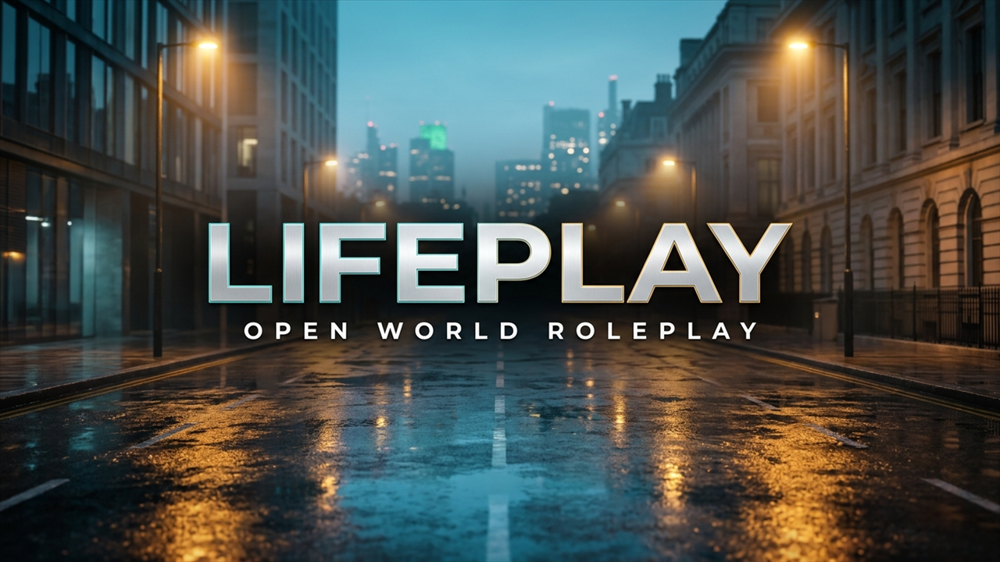

  

<h1 align="center">LifePlay v1.0</h1>

  <strong>Modern Open-World Life & Roleplay Simulation — Powered by Unreal Engine 5.8</strong>

---

## Highlights (`v1.0`)

* **GTA-Style Third-Person Character Control (`G`):** Toggle directly into third-person over-the-shoulder control with collision-tested camera, mouse look, scroll zoom, `WASD` movement, `Shift` sprint, and `Ctrl` walk.
* **Native Unreal Engine Interaction AI:** Autonomous NPC companion pace-matching, visual `LineOfSightTo` pedestrian awareness, NavMesh fleeing on intimidation, NavMesh `Call Over` (`F`), and ambient neighborhood street roaming.
* **Standalone Offline Roleplay Panel (`E` / `T`):** Zero external APIs or internet required — interact with NPCs via **Greet**, **Ask Life**, **Joke**, **Flirt**, **Gift £25**, **Follow Me**, **Stay**, **Call Over**, **Apologize**, **Provoke**, or free-text roleplay with persistent per-NPC memory and live stat updates.
* **Native 3D Spatial & Street Ambience Audio (`M`):** Contextual UE soundplay at NPC positions plus looping city street ambience.
* **Clean Modern Interface & Laptop-Friendly Performance:** Sleek dark-glass GTA HUD with live status indicators and DirectX 11 optimization tuned for smooth 60 FPS gameplay on 4 GB VRAM GPUs.

---

## Controls

| Key | Action |
| --- | --- |
| **`G`** | Toggle **GTA Third-Person Character Control** |
| **`W A S D`** | Move relative to camera (`LeftShift` Sprint, `LeftCtrl` Walk) |
| **`Mouse` / `Scroll`** | Orbit camera / Zoom distance |
| **`LeftAlt`** *(hold)* | Temporarily unlock cursor in GTA Mode |
| **`E` / `T`** | Open / Close **Roleplay & UE Interaction AI Panel** (`Esc` closes) |
| **`F`** | Call nearest NPC over to you (UE NavMesh AI) |
| **`M`** | Toggle Game Audio **ON / OFF** |
| **`Ctrl + C`** | Switch City (`CentralLondon` recommended) |

---

## Running & Releases (`v1.0`)

* **Standalone Play (`Play_LifePlay.bat`):** Double-click `Play_LifePlay.bat` for direct `-game` launch.
* **Packaged Windows Build (`LifePlay.exe`):** Check the **[Releases](../../releases)** page for `v1.0` standalone downloads.
